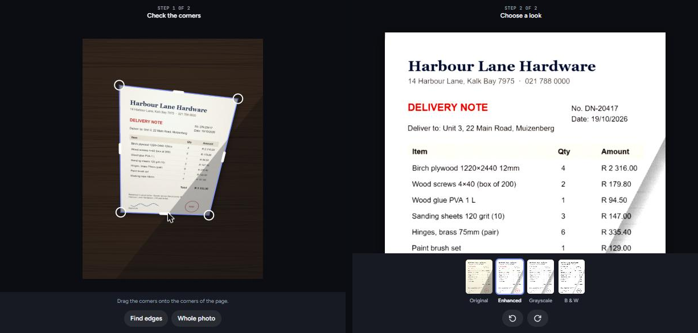

# Scanline

Scan paper into a clean PDF with your phone camera, in the browser.

**[Open Scanline](https://mjay-2015.github.io/scanline/)** · works offline once installed



## What it does

1. **Point at a page.** The live viewfinder outlines the page and takes the photo when it is steady.
2. **Check the corners.** Scanline finds the four corners itself; drag any it missed.
3. **Choose a look.** Original, enhanced, greyscale or black and white.
4. **Save the PDF.** A4, Letter, or the page's own shape, with several pages in one file.

Nothing is uploaded. The photos and the PDF stay on your device.

## How it works

There is no scanning library. Page detection, perspective correction, the filters and the PDF writer are written for this app:

- **Finding the page:** an edge outline plus a search for the four straight lines that make the best page-shaped quadrilateral.
- **True page shape:** the page's real width-to-height ratio is recovered from the perspective, so an A4 sheet photographed at an angle comes out A4.
- **Flattening:** a perspective warp of the four corners to a rectangle.
- **PDF:** written directly, and checked to open in strict PDF readers.

## Tests

- True page shape on 300 simulated phone photos.
- Page detection on 40 synthetic photos and 4 empty surfaces: at least 37 of 40 within 2.5%, and no pages found where there are none.
- Generated PDFs open in pypdf's strict mode and in pdf.js.

## Run it locally

It is a static site. Serve this folder over HTTPS or on localhost (the live camera needs one of the two), for example:

```
python -m http.server 8000
```

then open http://localhost:8000.

Designed, specified and tested by Natalie Donga; built with Claude Code.
